# Vector body swap

The vertex edit of the mid-engine supercar is abandoned. The nose ended behind the front axle and the hood creased. This note is the shortlist Carlos can veto. Licence check: 18 November 2026. Every file below was downloaded over plain HTTPS with no account and opened locally. Previews are the actual files, rendered in the running game viewer (front three-quarter, side, rear three-quarter).

## Pick

**tevy Classic 1970s Coupe**, LOD1 and LOD2.

It is a closed front-engine grand-tourer coupe with real glass, separate wheel nodes, and arches that already wrap the tyres. It does not carry badges, and it is not the Aventador-like supercar. The game still adds the cyan livery, the #27, the GT3 wing on two swan necks, and the diffuser. The publisher already ships meshopt + KTX2 LOD1 and LOD2, which is the same packing as Vanta and Aegis.

| | |
|---|---|
| Source | https://tevy.dev/models/classic-coupe |
| Files | `https://tevy.dev/models/classic-coupe/v1/lod1.glb`, `v1/lod2.glb` |
| Author | tevy |
| Licence | CC0 1.0 — https://creativecommons.org/publicdomain/zero/1.0/ |
| Commercial / modify / redistribute | Yes / yes / yes |
| Attribution | Not required |
| LOD1 | 15,051 triangles, 294,856 bytes, meshopt + KTX2 |
| LOD2 | 5,153 triangles published (file 109,220 bytes), meshopt + KTX2 |
| LOD0 (not shipped) | 56,130 triangles, 1.4 MB |
| Size | about 2.0 × 1.3 × 4.65 m |
| Wheels | `wheel_FL`, `wheel_FR`, `wheel_RL`, `wheel_RR`, plus `steer_FL` / `steer_FR` |
| Why it wins | Closed body, wheels inside the arches, quality in line with the other two imported cars, and a silhouette that is not the previous supercar |

## Also inspected

### 3DAssets.dev mid-engine GT race coupe — not used

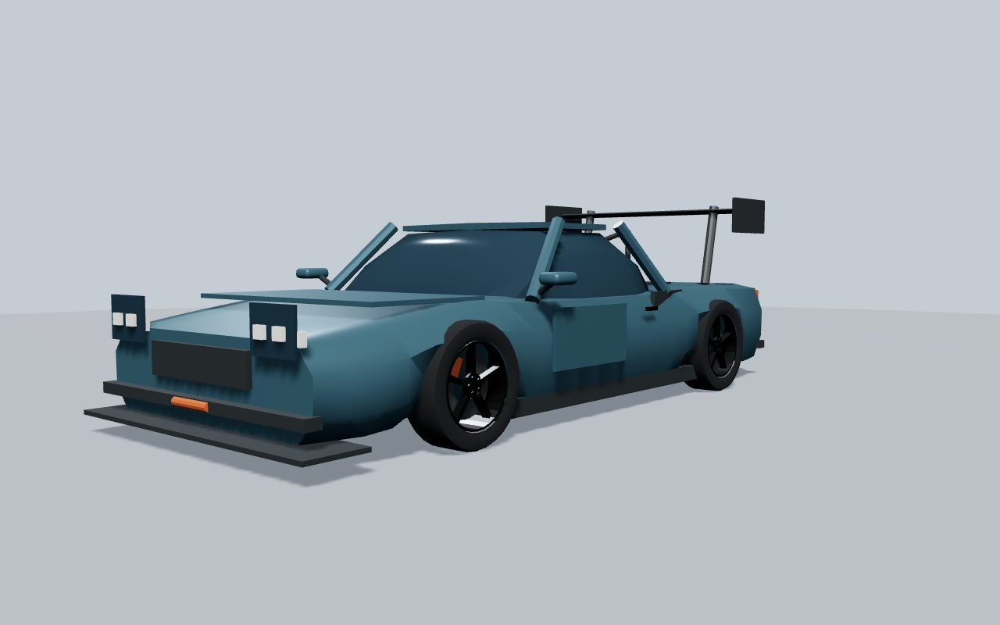
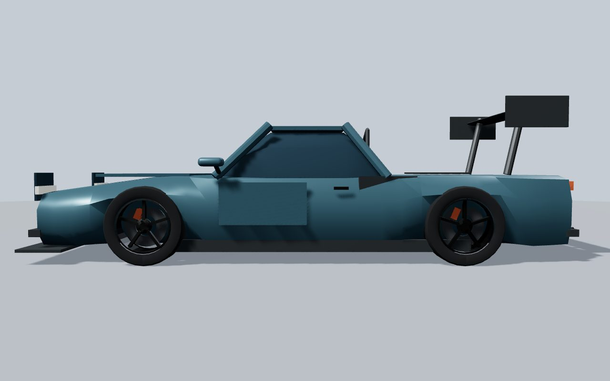
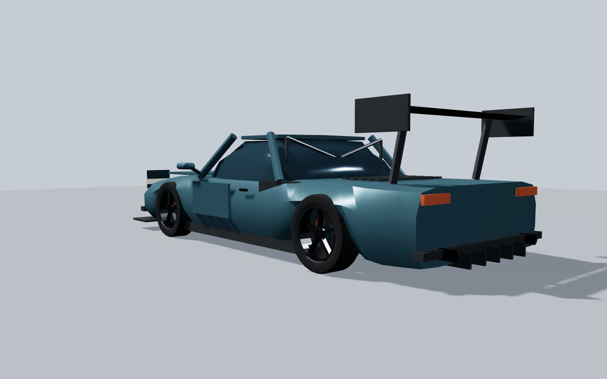

| | |
|---|---|
| Source | https://3dassets.dev/assets/endurance-and-gt-paddock-mid-engine-gt-coupe-0cbb6f3a |
| File | https://cdn.3dassets.dev/assets/14833/v1/model.glb |
| Author | 3DAssets.dev (pack: Endurance and GT Race Cars and Paddock). Page states the mesh was AI-assisted (Claude) and released by the publisher as CC0 |
| Licence | CC0 1.0, stated on the asset page. No login |
| Triangles | 8,192 measured |
| File size | 283 KB |
| Size | 2.24 × 1.41 × 4.79 m |
| Wheels | `wheel-front-left/right`, `wheel-rear-left/right` |
| Why not | The class is right, but the body is a low-poly block with a broken cage roof and a wing that does not meet the deck. It would sit next to the detailed Vanta and Aegis bodies and read as a different game |

### 3DAssets.dev front-engine GT race coupe — not used

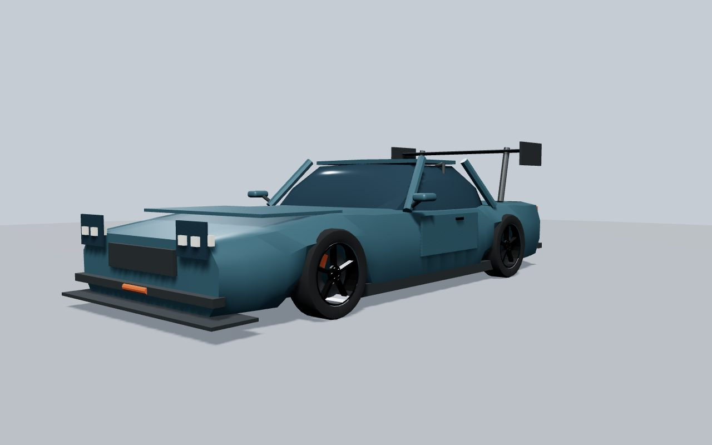
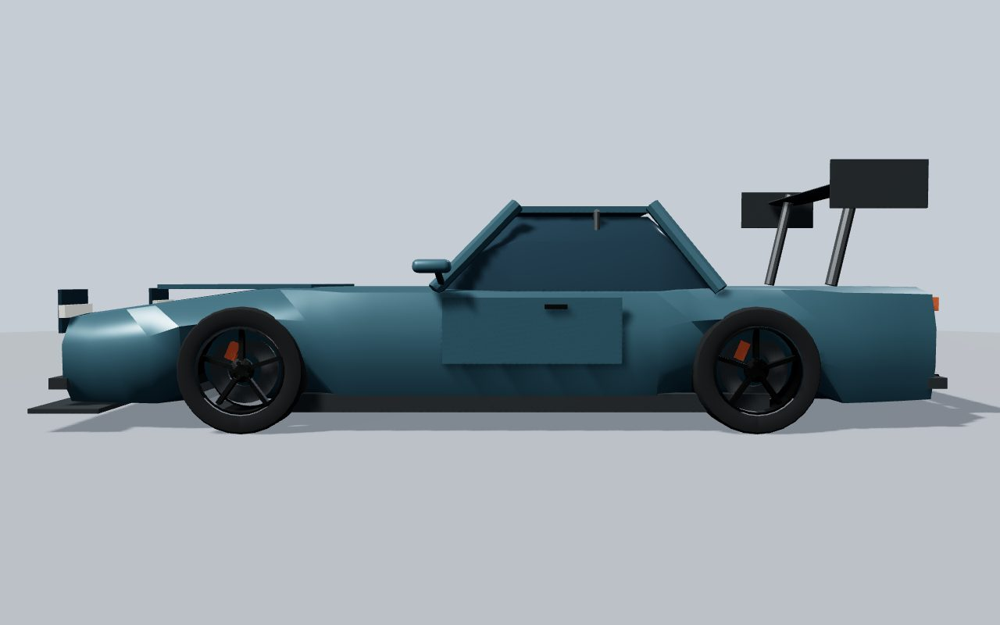
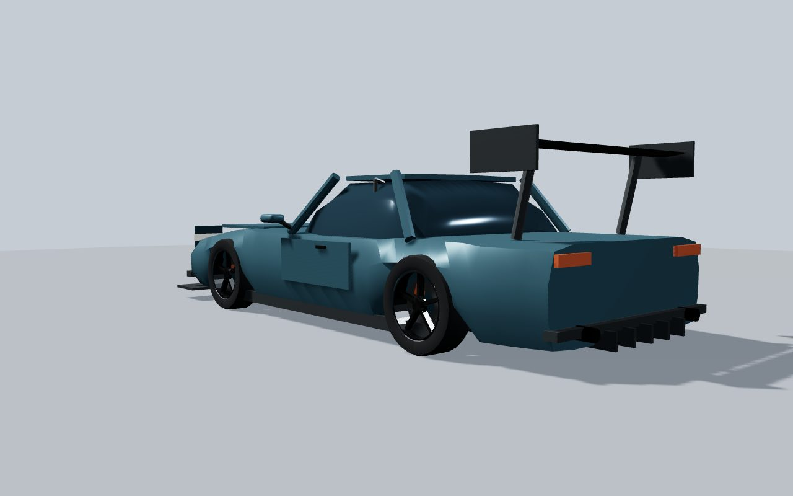

| | |
|---|---|
| Source | https://3dassets.dev/assets/endurance-and-gt-paddock-front-engine-gt-coupe-ff0949d7 |
| File | https://cdn.3dassets.dev/assets/14834/v1/model.glb |
| Licence | CC0 1.0, same pack and terms as the mid-engine car |
| Triangles | 8,108 measured |
| File size | 278 KB |
| Size | 2.27 × 1.47 × 5.04 m |
| Why not | Same construction as the mid-engine car: long hood is the right idea, the mesh is not |

### 3DAssets.dev 1990s GT1-style coupe — not used

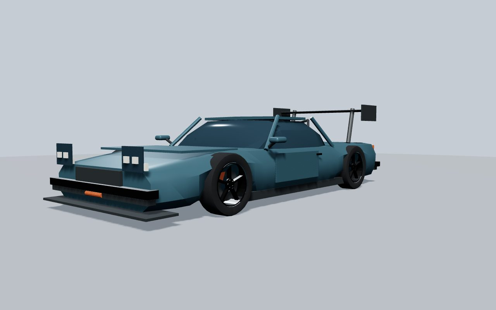
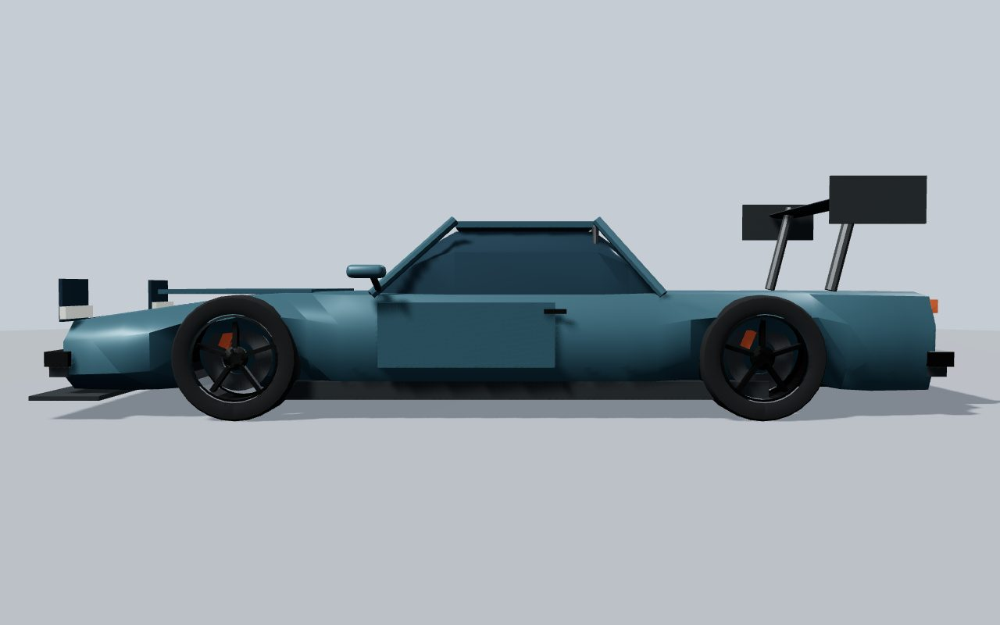
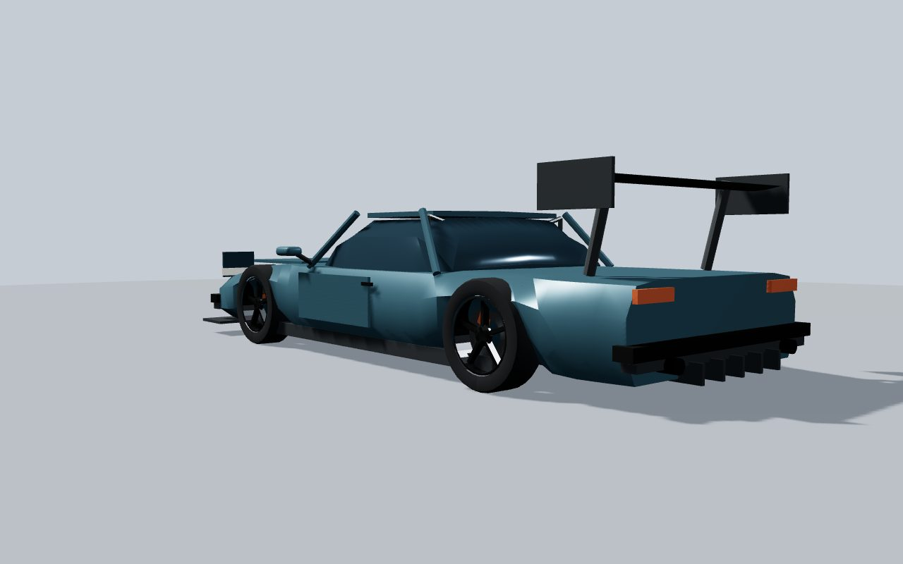

| | |
|---|---|
| Source | https://3dassets.dev/assets/endurance-and-gt-paddock-gt1-coupe-8b02af45 |
| File | https://cdn.3dassets.dev/assets/14844/v1/model.glb |
| Licence | CC0 1.0, same pack |
| Triangles | 8,132 measured |
| File size | 280 KB |
| Size | 2.26 × 1.33 × 5.09 m |
| Why not | Same low-poly pack. The long nose is closed, but the roof and wing are the same unfinished shapes |

### tevy Classic 1970s Coupe — chosen

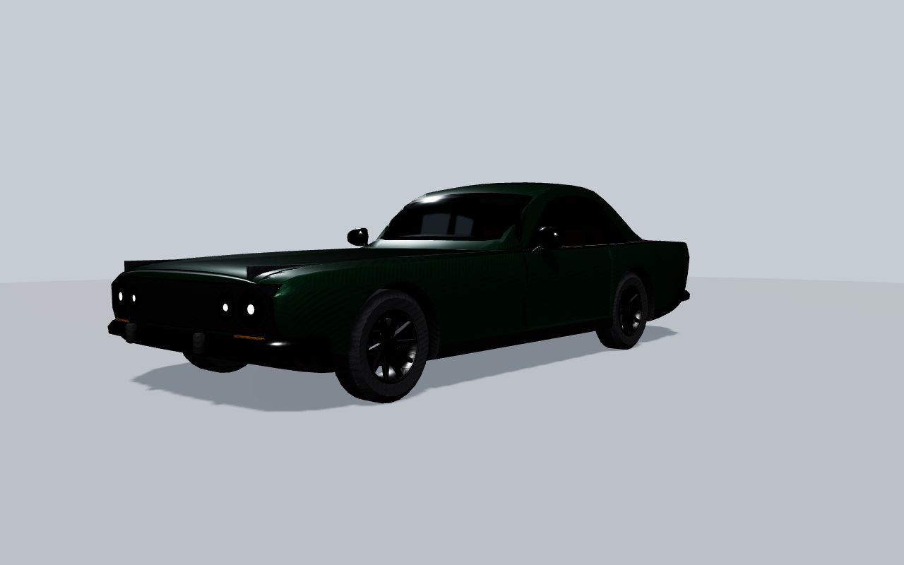
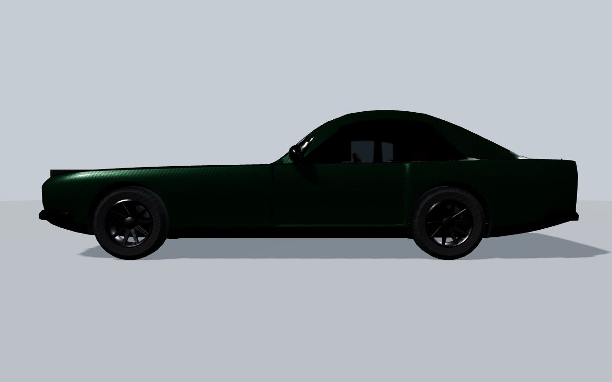
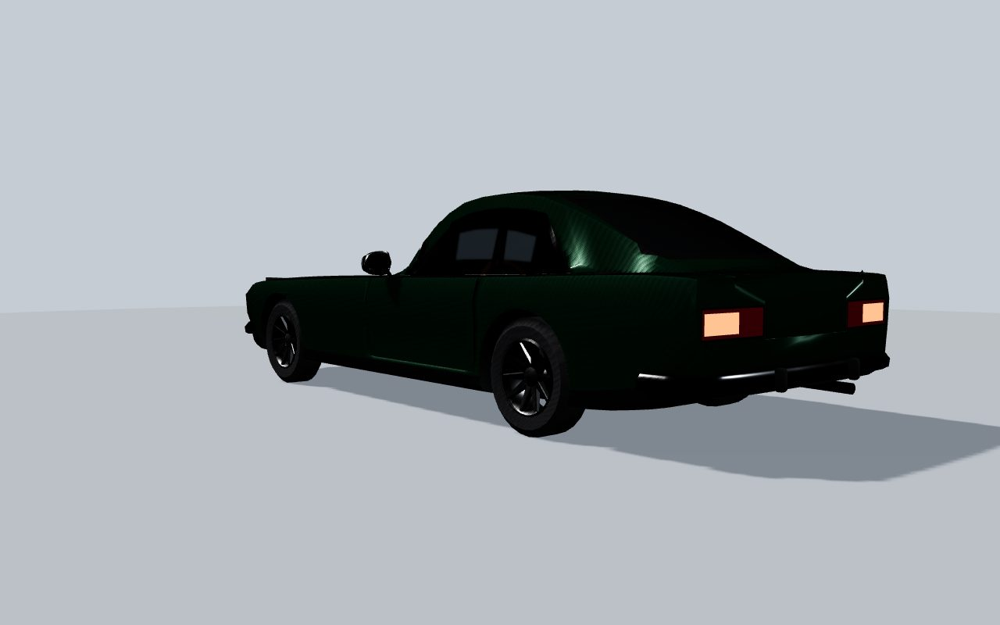

See the pick above. Quad lamps and a plain grille, no badges. It is a 1970s grand tourer rather than a modern silhouette GT3, which is the trade for a closed body that matches the other cars.

tevy Muscle Car (`https://tevy.dev/models/muscle-car`, CC0, LOD1 14,135 triangles) was downloaded and not rendered into this set. The publisher describes a late-1960s fastback with a hood scoop and stripes, which is too close to one production shape to be the Vector.

The previous mid-engine supercar stays rejected. Its page is https://tevy.dev/models/supercar. It reads as one specific modern supercar, and editing its vertices put the nose behind the front axle.
